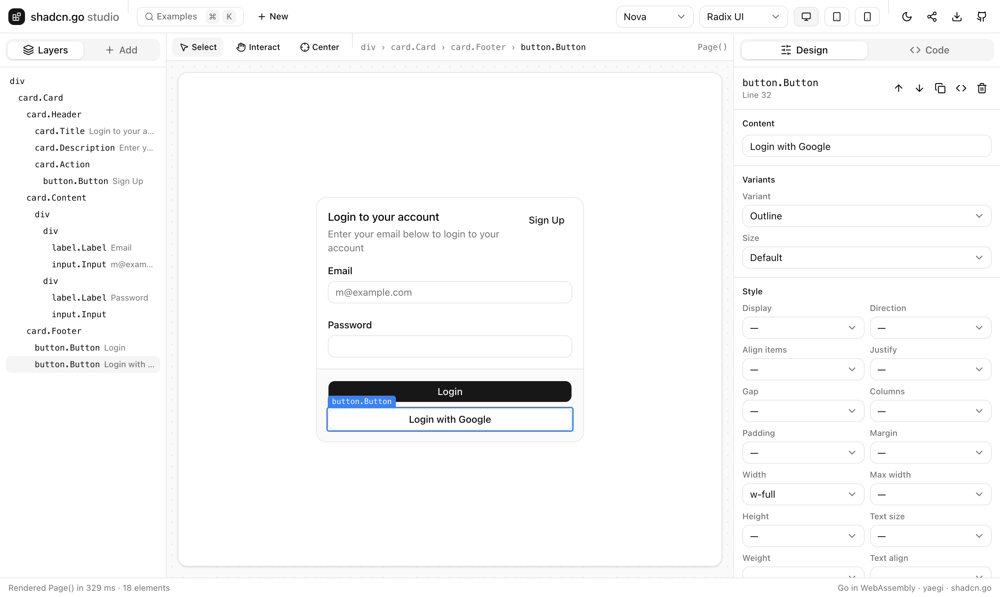

# shadcn.go studio

A visual editor for [shadcn.go](https://github.com/alexisbcz/components):
design Go user interfaces in the browser. The Go code is the document, and
Go itself runs in the page, compiled to WebAssembly.

**Open it: <https://alexisbcz.github.io/studio/>**



## What it does

- **Canvas**: renders your `func Page() h.Node` live, in any of the 8 styles
  and with Radix UI, Base UI or React Aria layouts, at desktop, tablet or
  mobile width, light or dark. Interact mode lets you use the page: dialogs,
  menus and tabs work.
- **Select**: click an element on the canvas, in Layers or in the code. The
  three stay in sync, because each element maps back to the Go call that
  rendered it.
- **Edit visually**: change text, variants (`button.VariantOutline`), sizes
  and Tailwind classes, with designer controls for layout, spacing and
  typography. Move, duplicate, delete or wrap elements in a row, column or
  grid.
- **Add components**: 47 palette entries, from a button to a dropdown menu.
  Click to add inside the selection, or drag onto the canvas or the layers.
  Imports are added for you.
- **Code**: a Go editor next to the canvas. Visual edits rewrite the source
  and gofmt it; code edits re-render as you type. Errors are marked on their
  line.
- **Examples**: the 861 shadcn/ui docs examples ported to Go, a ⌘K away.
- **Share and download**: a link holds the whole page; download it as
  `page.go`.

Shortcuts: ⌘K examples, ⌫ delete, ⌘D duplicate, Alt+↑/↓ move, ↑/↓ walk the
layers, ⌘Z undo, ⌘S format, Esc deselect.

## How it works

- `engine` interprets the page with [yaegi](https://github.com/traefik/yaegi),
  a Go interpreter, against the compiled shadcn.go packages (`symbols`,
  generated by `yaegi extract`). Before running, it adds a prop to each
  component call so that the rendered element carries
  `data-studio-src="<call>"`. It also inspects and edits calls on the syntax
  tree, so visual edits are source edits.
- `cmd/wasm` compiles the engine to WebAssembly. It runs in a Web Worker
  (`web/worker.js`), which restarts on endless loops.
- `cmd/build` builds the static site. The studio's own page is rendered with
  shadcn.go, and its CSS comes from the Go port of Tailwind CSS. The
  components' runtime JavaScript is exported next to them. In the canvas,
  classes only your code has are compiled by Tailwind's browser build.

```sh
go run ./cmd/build   # builds ./site
go run ./cmd/serve   # http://localhost:8091
go test ./...
```

## Limits

- The interpreter does not support every Go feature. 859 of the 861 docs
  examples run; `sidebar-07` and `sidebar-08` trip over interpreter bugs.
- libhtml's generic helpers (`h.Map`, `h.If`, ...) are rewritten for the
  interpreter. `h.MapSeq` and `h.Switch` are not available.
- The engine is about 8 MB to download, once.

## License

MIT
